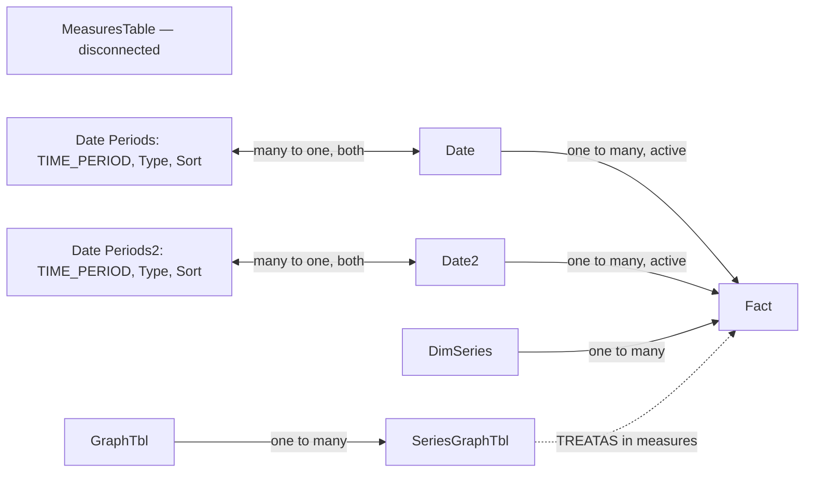

# Model and design specification



The saved `diagramLayout.json` puts MeasuresTable above Fact, Date on the left,
Date2 on the right, and their period tables below, following the reference.
The three catalogue/series tables sit to the right of the core arrangement.
The unrelated download measures and expressions visible in the screenshot were
not copied as placeholders: their definitions were not supplied.

| Table | Purpose / grain |
| --- | --- |
| Fact | One series, one observation period; FREQ, Legend, OBS_VALUE, SERIES_CODE, SeriesName, TIME_PERIOD |
| Date | Daily calendar, marked as a date table by Date key and Time category |
| Date2 | Independent copy of Date for a second/comparison date selection |
| Date Periods / Date Periods2 | One date per supported period membership: 1Y, 5Y, All; not a fact join |
| MeasuresTable | Hidden one-row support column and 32 explicit measures |
| GraphTbl | One chart/KPI definition per graph_id |
| SeriesGraphTbl | One distinct graph/code/legend mapping; transform, axis and series order included |
| DimSeries | One concrete SERIES_CODE per series |

Both date paths are active, as in the model image. Simultaneous Date and Date2
filters intersect on Fact. No comparison-chart UI is implemented on the home
page; Date2 is retained to match the requested model. Window/KPI measures remove
the secondary date and period filters when seeking prior observations so date
selection does not erase the history required by the calculation.

Your Date expression, as supplied:

```dax
Date =
ADDCOLUMNS(
    CALENDAR(MIN('Fact'[TIME_PERIOD]), MAX('Fact'[TIME_PERIOD])),
    "Year", YEAR([Date]),
    "Month Number", MONTH([Date]),
    "Quarter", QUARTER([Date]),
    "Week Number", FORMAT(WEEKNUM([Date], 1), "00"),
    "Year_Month", FORMAT([Date], "YYYY") & "-" & FORMAT(MONTH([Date]), "00")
)
```

The implementation supplies COALESCE guards for an empty Fact and adds the
month-start `DateForGraph_M` visible in your earlier model screenshot.
There is no fallback or imputed observation in Fact.

## Home-page design tokens and placement

| Item | Canvas coordinates / style |
| --- | --- |
| Canvas | 1300 × 1450; white; FitToPage |
| Header | Hebrew title at x530/y20, width760/height76; Arial 38pt bold |
| Navigation | Right-to-left at y92; home teal rule at y140 |
| KPI blocks | y185; x1000, 667, 334, 0; 300 × 246 |
| KPI header / separator | Navy #193B60; gold #E7BF3C, height10 |
| Graph panels | g01 x660/y500; g02 x0/y500; g03 x660/y982; g04 x0/y982; 640 × 458 |
| Plot rectangles | Panel offset x16/y73; 608 × 268 |
| Surfaces | #F4F4F4 panel; white plot |
| Series | Teal #089BB4; orange #F18A18; green #38832B |
| Labels/grid | #728197 labels; #E5E8EC dotted grid |

The dotted border and Power BI editor panes in the reference screenshot are
editor UI and are not part of the saved report design.

## Home chart calculations

| Graph | Code(s) | Transform | Axes |
| --- | --- | --- | --- |
| g01 | UE_R_A25_64_M_SA; LF_R_A25_64_M_SA; EM_R_A25_64_M_SA | Native rates | Unemployment primary; participation/employment secondary |
| g02 | EP_M_SA; EM_M_SA | (current/prior-year − 1) × 100; 3-observation monthly average | Percent |
| g03 | LMS_JOB_OPENINGS_TOT_M_SA; LMS_JOB_OPENINGS_TOT_PCT_M_SA | Three-month average | Count columns primary; rate line secondary |
| g04 | AW_ANNPCT_Q_SA | Raw supplied annual percentage change; average of four quarters | Percent |

Moving-average calculations use observed period dates rather than all rows in
the daily calendar. They require complete windows and do not substitute missing
values. Raw percentage observations are displayed with a literal `%` suffix,
avoiding the ×100 multiplication of a percentage format.

The g04 source subtitle mentions employed-person growth although its series
code is wage growth. It is retained verbatim from GraphTbl rather than silently
rewritten; confirm that text when you review the report in Desktop.
